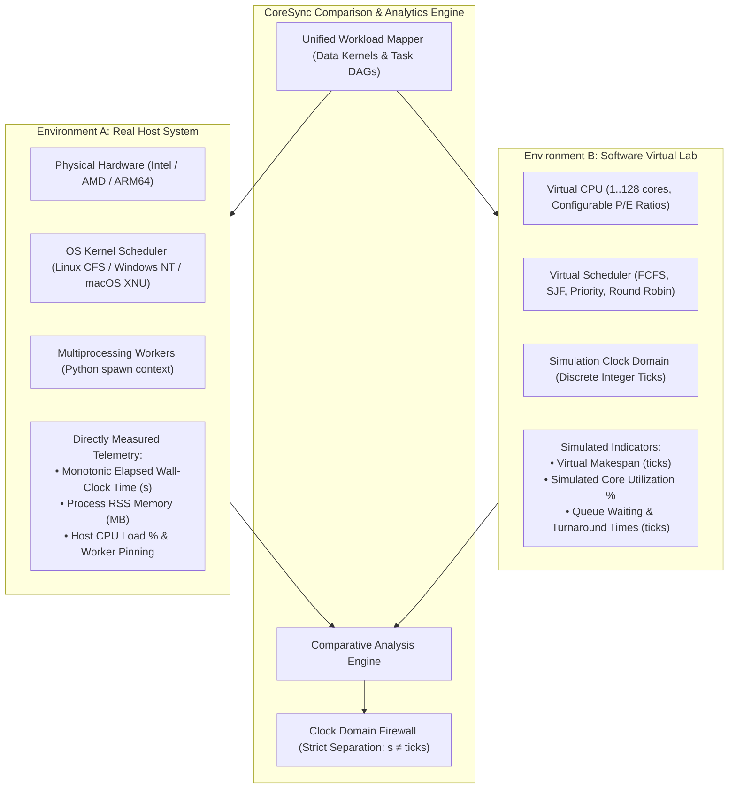
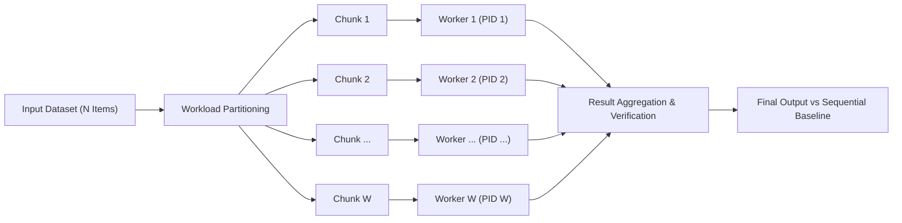
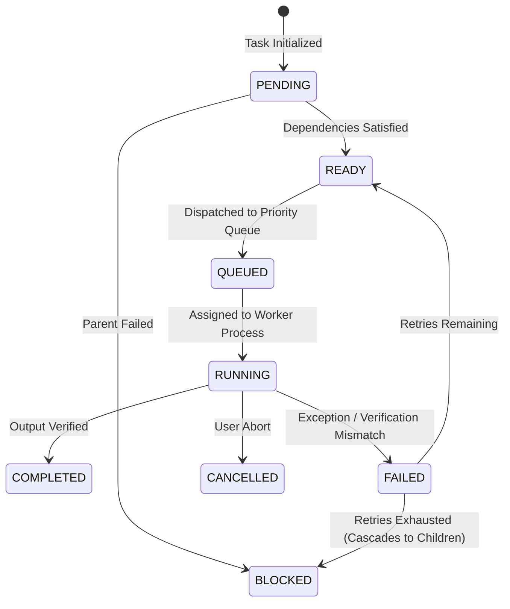
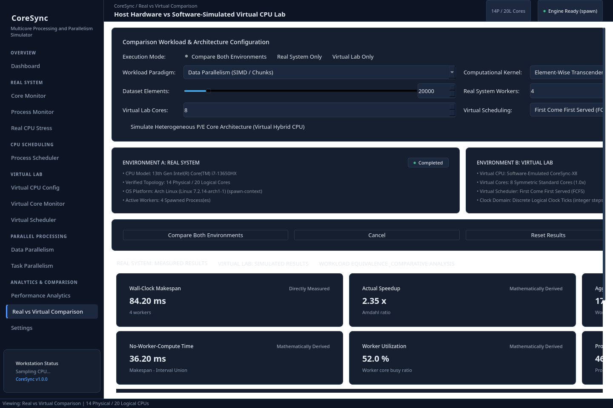
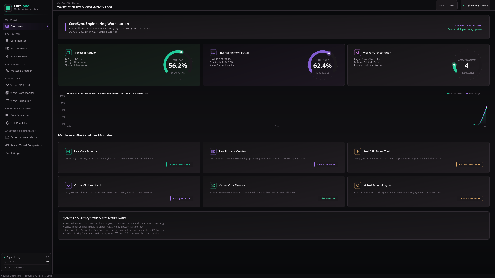
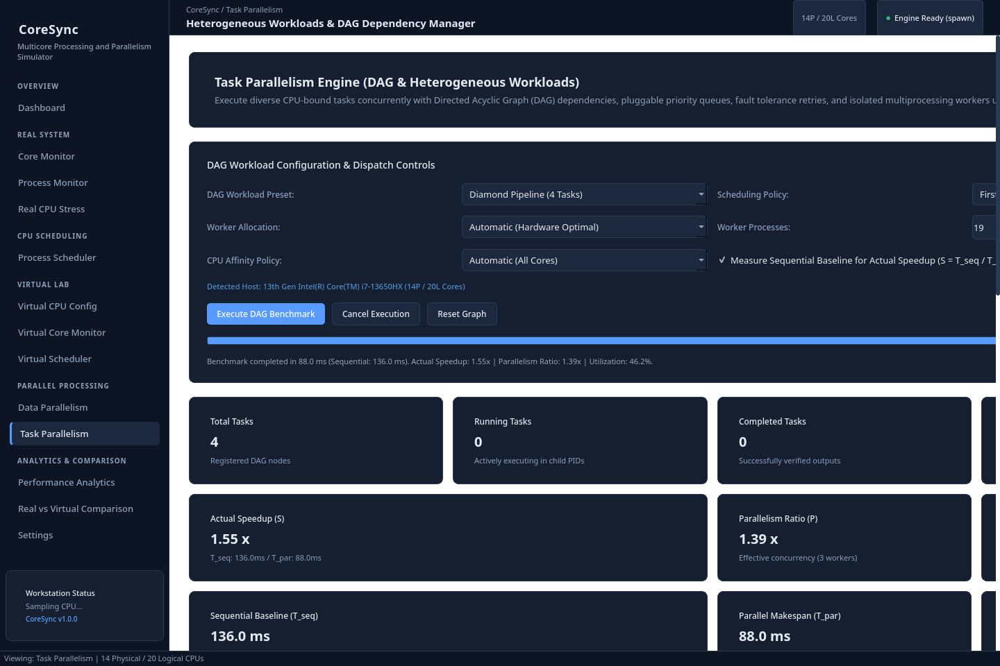
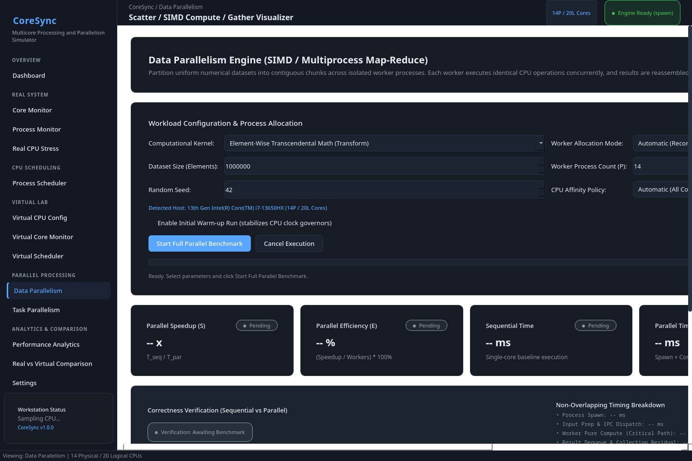
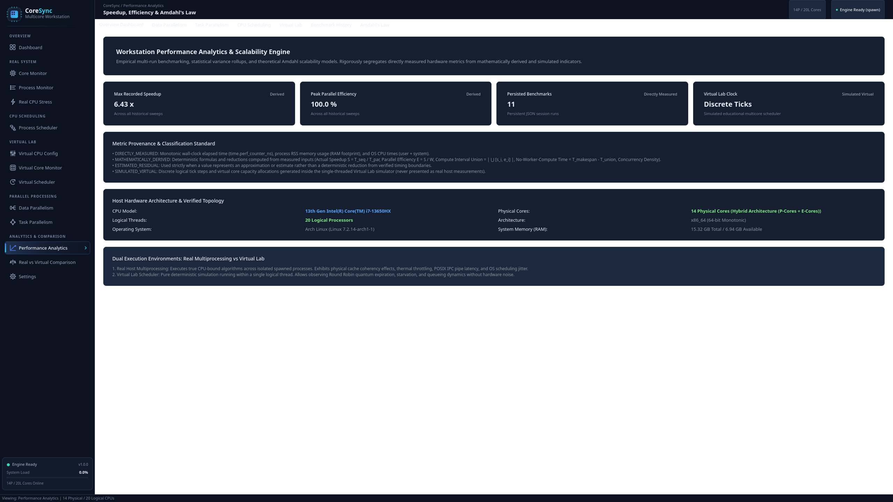

# CoreSync: Multicore Processing & Parallelism Workstation

<p align="center">
  <b>Understand. Simulate. Execute. Analyze.</b>
</p>

<p align="center">
  <a href="LICENSE"></a>
  <a href="https://www.python.org/"></a>
  <a href="docs/INSTALLATION.md"></a>
  <a href="docs/TESTING.md"></a>
  <a href="docs/ARCHITECTURE.md"></a>
  <a href="docs/USER_GUIDE.md"></a>
</p>

**CoreSync** is a desktop-based multicore processing and parallelism engineering workstation designed to explore, execute, simulate, and analyze modern CPU multiprocessing and operating systems concepts.

It brings real-world hardware monitoring, virtual multicore processor simulation, parallel computing paradigms, process management, CPU scheduling, and performance analytics together in a single unified application.

Built with **Python**, **PySide6 (Qt 6)**, **NumPy**, **psutil**, and **Matplotlib**, CoreSync provides an interactive desktop environment for understanding how computational workloads are distributed across CPU cores, how processes are scheduled, and how parallel execution affects system performance.

---

## Table of Contents

- [Overview](#overview)
- [Features](#features)
  - [1. Real Hardware Monitoring](#1-real-hardware-monitoring)
  - [2. Real CPU Stress Testing](#2-real-cpu-stress-testing)
  - [3. Virtual Multicore Processor](#3-virtual-multicore-processor)
  - [4. Data Parallelism](#4-data-parallelism)
  - [5. Task Parallelism & DAG Execution](#5-task-parallelism--dag-execution)
  - [6. CPU Scheduling Simulator](#6-cpu-scheduling-simulator)
  - [7. Performance Analytics](#7-performance-analytics)
  - [8. Real System vs Virtual Lab Comparison](#8-real-system-vs-virtual-lab-comparison)
- [System Architecture](#system-architecture)
  - [Architectural Principles](#architectural-principles)
- [Technology Stack](#technology-stack)
- [Application Modules](#application-modules)
- [Performance Metrics](#performance-metrics)
- [Installation](#installation)
  - [Prerequisites](#prerequisites)
  - [Linux](#linux)
  - [Windows 10 / Windows 11](#windows-10--windows-11)
  - [macOS](#macos)
- [Running CoreSync](#running-coresync)
- [Testing](#testing)
- [Workstation Screenshots](#workstation-screenshots)
- [Project Structure](#project-structure)
- [Platform Compatibility](#platform-compatibility)
- [Documentation](#documentation)
- [Known Limitations](#known-limitations)
- [Contributing](#contributing)
- [License](#license)
- [Project Status](#project-status)

---

## Overview

Modern processors use multiple physical cores, symmetric multithreading (SMT), and dynamic scheduling strategies to execute complex workloads efficiently. Understanding these mechanisms requires more than theoretical explanations.

CoreSync provides a practical environment to investigate these concepts through real hardware monitoring and software-based multicore simulation.

The application is architected around two strictly isolated execution environments:

### Environment A: Real System
Interacts directly with the physical computer's actual hardware and host operating system:
- Actual CPU hardware topology, model detection, and core architecture.
- Physical and logical processor classification.
- Real-time CPU per-core utilization and frequency monitoring.
- Physical RAM utilization and process RSS memory tracking.
- Running host process inspection and worker identification.
- CPU affinity management and core pinning where supported by the OS.
- Controlled CPU-intensive workload execution using true multi-process worker pools.
- Strict child process lifecycle management and orphan prevention.

### Environment B: Virtual Lab
Provides an isolated, software-based multicore processor simulation:
- Configure custom simulated processors with 1 to 128 virtual cores.
- Model heterogeneous architectures with asymmetric P-core and E-core performance ratios ($0.5\times$ to $2.0\times$ cycle throughput).
- Simulate concurrent task execution across independent virtual cores.
- Experiment with scheduling algorithms (FCFS, Priority, Round Robin).
- Observe virtual core utilization matrices and cycle throughput.
- Study workload distribution and scheduling behavior free from physical hardware noise.

> [!IMPORTANT]
> **Clock Domain Separation**: Real hardware measurements and virtual simulation results are maintained strictly separately. Physical elapsed time is measured in seconds using monotonic hardware clocks (`time.perf_counter_ns()`), while virtual execution is represented using discrete logical simulation ticks. Virtual simulation ticks are never conflated with real elapsed seconds, and virtual utilization is never presented as actual CPU load.



---

## Features

### 1. Real Hardware Monitoring
Inspect the physical computer running CoreSync with live per-core metrics:
- **CPU Identification**: CPU manufacturer, model name, physical core count, and logical processor count.
- **Topology & Architecture**: Microarchitecture detection and asymmetric Performance (P-core) vs. Efficient (E-core) identification on supported hybrid hardware (Intel 12th+ Gen, Apple Silicon).
- **Per-Core Telemetry**: Live per-processor utilization heatmaps and clock frequencies (where provided by host OS).
- **Physical Memory**: Real-time system RAM consumption, available memory, and process RSS tracking.
- **Process Inspection**: Comprehensive host process table with dynamic CoreSync worker process identification and filtering.
- **Dynamic Probing**: Hardware attributes are discovered dynamically at runtime rather than relying on static or hardcoded specifications.

### 2. Real CPU Stress Testing
Generate controlled, safety-bounded CPU-intensive workloads using actual child worker processes:
- **Multiprocessing Architecture**: Spawns isolated worker processes pinned across selected logical processors.
- **Configurable Parameters**: User-selectable worker count (1 to host maximum), adjustable duty-cycle throttling, and thread affinity policies.
- **Hardware Safety Limits**: Hard 30-second execution cap to prevent thermal runaway or host freezing.
- **Worker Reaping**: Immediate cooperative cancellation support with guaranteed clean worker termination.

### 3. Virtual Multicore Processor
Experiment with diverse processor architectures without requiring physical hardware changes:
- **Scalable Topologies**: Configure virtual processors with 1 to 128 virtual cores.
- **Heterogeneous Core Modeling**: Configure asymmetric P-core and E-core performance characteristics ($0.5\times$ to $2.0\times$ cycle throughput).
- **Synthetic Workload Generator**: Inject synthetic task batches with configurable burst profiles, memory footprints, and priorities.
- **Virtual Core Monitor**: Real-time matrix visualizer observing simulated cycle throughput, per-core utilization, and task queue states.
- **Pedagogical Isolation**: Virtual metrics operate deterministically on discrete simulation ticks, completely isolated from hardware noise.

---

### 4. Data Parallelism

Explore how large computational datasets are partitioned into smaller chunks and executed concurrently across worker pools.



#### Capabilities
- **Partitioning Strategies**: Even chunk slicing, uneven remainder distribution, and high-performance NumPy array slicing.
- **CPU-Bound Kernels**: Transcendental trigonometry, prime number counting, matrix norms, and numerical polynomials.
- **Worker Monitoring**: Live worker lifecycle tracking, assigned CPU core affinity masks, and process memory monitoring.
- **Output Verification**: Strict numerical verification comparing parallel results against a single-threaded baseline ($\text{rtol} = 10^{-5}, \text{atol} = 10^{-8}$).
- **Speedup & Efficiency Analysis**: Exact measurement of speedup curves, parallel efficiency percentages, processing throughput, and residual overheads.

---

### 5. Task Parallelism & DAG Execution

Execute complex workflows containing interdependent and independent tasks modeled as Directed Acyclic Graphs (DAGs).



#### Task Lifecycle States

| State | Description |
| :--- | :--- |
| **`PENDING`** | Task initialized; waiting for parent dependencies to finish |
| **`READY`** | All upstream parent dependencies satisfied; eligible for dispatch |
| **`QUEUED`** | Placed into the active ready queue awaiting an available worker |
| **`RUNNING`** | Currently executing on an assigned child worker process |
| **`COMPLETED`** | Execution finished successfully and numerical output verified |
| **`FAILED`** | Task execution encountered an exception or verification mismatch |
| **`CANCELLED`** | Execution was aborted cooperatively by the user |
| **`BLOCKED`** | Task cannot run because an upstream parent dependency failed |

#### Capabilities
- **Graph Validation**: Strict topological sorting, dependency validation, and cycle detection.
- **Built-in Workload Presets**: Diamond Pipeline, Scientific Suite (7 tasks), Independent Fan-Out/Fan-In, Matrix Pipeline.
- **Pluggable Queue Policies**: First-Come First-Served (FIFO), Priority-based, and Shortest Job First (SJF).
- **Fault Tolerance**: Configurable task retries with exponential backoff and downstream failure propagation.
- **Vector DAG Canvas**: Zoomable, interactive vector canvas visualizing dynamic task states, dependencies, and execution progress.

---

### 6. CPU Scheduling Simulator

Study, simulate, and compare classic uniprocessor and multicore CPU scheduling algorithms.

| Algorithm | Preemption Mode | Primary Selection Metric | Starvation Protection |
| :--- | :--- | :--- | :--- |
| **First Come First Serve (FCFS)** | Non-preemptive | Arrival Time ($T_{\text{arrival}}$) | Inherent FIFO ordering |
| **Shortest Job First (SJF)** | Non-preemptive | Expected Burst Time ($T_{\text{burst}}$) | None |
| **Shortest Remaining Time First (SRTF)** | Preemptive | Remaining Burst Time ($T_{\text{remaining}}$) | None |
| **Priority Scheduling** | Non-preemptive | Static / Effective Priority Value | Dynamic Priority Aging |
| **Preemptive Priority** | Preemptive | Highest Priority Process | Dynamic Priority Aging |
| **Round Robin (RR)** | Preemptive | Time Quantum ($\tau$) expiration | Time-sliced round robin |

#### Visualizer & Metrics
- Interactive vector Gantt chart with zoom, drag, and execution block inspection.
- Complete execution timeline step-through.
- Comparative multi-algorithm evaluation matrix dialog.
- Comprehensive metrics: Average Waiting Time ($WT$), Turnaround Time ($TAT$), Response Time ($RT$), Normalized Turnaround Time ($NTAT$), CPU Utilization, Throughput, and Context Switch count.

---

### 7. Performance Analytics

Analyze the scalability, efficiency, and overhead of parallel workloads using empirical measurements and theoretical models:
- **Baseline Comparison**: Direct speedup calculation ($S = T_{\text{seq}} / T_{\text{par}}$) and parallel efficiency ($E = S / W$).
- **Amdahl's Law Calculator**: Interactive theoretical speedup curve modeling with empirical parallel fraction derivation.
- **Interval Timing Decomposition**: Mathematical decomposition of makespan into active worker compute intervals and no-worker-compute overhead.
- **Benchmark History Persistence**: Session tracking across Data Parallelism, Task Parallelism, and Scheduling simulations with JSON export and statistical variance analysis.
- **Metric Provenance**: Rigorous categorization distinguishing directly measured, derived, estimated, and simulated values.

---

### 8. Real System vs Virtual Lab Comparison

Compare physical workload execution on host hardware directly against software-simulated processor execution:
- **Execution Modes**:
  - **Real Only**: Executes workloads exclusively using physical multiprocessing workers.
  - **Virtual Only**: Executes workloads exclusively inside the software-simulated Virtual Lab.
  - **Compare Both**: Executes both environments under a sequential protocol (Real System executes first to eliminate background simulation interference).
- **Workload Mapping**: Translates high-level workloads (e.g., transcendental arrays, diamond DAGs) into equivalent task graphs in both domains.
- **Completion Order Concordance**: Evaluates execution sequence similarity using normalized Spearman's Rank Correlation ($C_{\text{order}} \in [0.0, 1.0]$).
- **Resource Allocation Ratio**: Computes the worker-to-virtual-core ratio ($R_{\text{alloc}} = W_{\text{real}} / C_{\text{virtual}}$).
- **Clock Domain Firewall**: Enforces strict structural separation between wall-clock seconds and virtual ticks, prohibiting invalid cross-domain ratios.

---

## System Architecture

CoreSync follows a modular, decoupled architecture that enforces strict separation of concerns between GUI presentation, computation engines, operating system interfaces, and background telemetry.

```
+-------------------------------------------------------------------------+
|                       CoreSync Workstation Layer                        |
|   +--------------------+-----------------------+--------------------+   |
|   | Overview Dashboard | Real System Monitors  | Virtual Lab Studio |   |
|   | Parallel Workbenches| CPU Schedulers        | Analytics Workstation| |
|   +--------------------+-----------------------+--------------------+   |
+-------------------------------------------------------------------------+
                                    | (Qt Signals / Worker Threads)
                                    v
+-------------------------------------------------------------------------+
|                          Core Services Layer                            |
|   +-----------------------+---------------------+-------------------+   |
|   |    Process Manager    |   Resource Guard    | CPU Monitor Svc   |   |
|   |  (Spawn Architecture) |  (Headroom Limits)  | (psutil Poller)   |   |
|   +-----------------------+---------------------+-------------------+   |
+-------------------------------------------------------------------------+
                                    |
          +-------------------------+-------------------------+
          | (Isolated Execution)                              | (Deterministic Model)
          v                                                   v
+---------------------------------------+   +---------------------------------------+
|        Environment A: Real System     |   |      Environment B: Virtual Lab       |
|  • Data Parallel Engine (Slicing/IPC) |   |  • Virtual Multicore CPU (1..128 C)   |
|  • Task Parallel DAG Engine (Queues)  |   |  • Asymmetric P/E Performance Model   |
|  • Real CPU Stress Generator (Safety) |   |  • Discrete Simulation Tick Engine    |
|  • Multi-Process Worker Pool (Spawn)  |   |  • Virtual Multi-Queue Scheduler      |
|  • Platform Hardware Providers (HAL)  |   |  • Synthetic Workload Generator       |
+---------------------------------------+   +---------------------------------------+
                                    |                         |
                                    +------------+------------+
                                                 |
                                                 v
                               +-----------------------------------+
                               |  Comparison & Analytics Engine    |
                               |  • Workload Canonical Mapper      |
                               |  • Concordance & Rank Correlation |
                               |  • Metric Provenance Engine       |
                               |  • Clock-Domain Firewall (s ≠ t)  |
                               +-----------------------------------+
```

### Architectural Principles

1. **Process Isolation**: CPU-intensive operations execute strictly in separate worker processes to prevent blocking the graphical interface.
2. **Spawn Multiprocessing**: Enforces Python's `spawn` multiprocessing context across all platforms (`multiprocessing.get_context("spawn")`), eliminating `fork()` lock deadlocks between Qt and POSIX threads.
3. **Triple-Shield Orphan Prevention**:
   - **Linux**: Child processes register `prctl(PR_SET_PDEATHSIG, SIGTERM)`.
   - **Windows**: Child processes open a synchronization handle to parent PID via Win32 `OpenProcess(SYNCHRONIZE, ...)`.
   - **Cross-Platform**: Child watchdogs monitor parent PID liveliness every 100ms. If the master application terminates unexpectedly, all child workers terminate immediately.
4. **GUI / Engine Decoupling**: Computation engines under `engine/` have zero imports from `PySide6`. Communication between the GUI and engines occurs via dedicated worker threads and thread-safe Qt Signals.
5. **Hardware Abstraction Layer (HAL)**: Platform-specific operations are encapsulated into dedicated providers (`LinuxHardwareProvider`, `WindowsHardwareProvider`, `MacOSHardwareProvider`).
6. **Strict Metric Provenance**: CoreSync strictly segregates directly measured, derived, estimated, and simulated metrics across all models and UI views.
7. **Clock-Domain Separation**: Monotonic elapsed wall-clock seconds and virtual simulation ticks are maintained in distinct clock domains and are never conflated.

---

## Technology Stack

| Technology | Version | Purpose in CoreSync |
| :--- | :--- | :--- |
| **Python** | `3.11+` | Core programming language, object models, and computation routines |
| **PySide6 (Qt 6)** | `6.12.0` | Desktop GUI framework, event management, and custom vector canvases |
| **NumPy** | `2.5.0+` | High-performance numerical operations and array kernel evaluations |
| **psutil** | `7.2.2+` | Host hardware telemetry, CPU load sampling, and process inspection |
| **Matplotlib** | `3.10.0+` | Scalability curve plots, Amdahl modeler, and performance analytics |
| **multiprocessing** | Standard Library | Parallel execution engine operating strictly under `spawn` context |
| **pytest & pytest-qt** | `9.2.0` / `4.5.0` | Automated testing framework for unit, integration, and GUI verification |

---

## Application Modules

CoreSync organizes its capabilities across 13 dedicated workstation modules:

| Index | Module | Category | Primary Purpose |
| :---: | :--- | :--- | :--- |
| **0** | **Dashboard** | Overview | System activity feed, real-time CPU/RAM gauges, 60s sparkline timeline, and module hub |
| **1** | **Core Monitor** | Real System | Physical and logical core topology, SMT threads, and live per-core utilization heatmaps |
| **2** | **Process Monitor** | Real System | Host process inspection, CoreSync child worker tracking, and affinity management |
| **3** | **Real CPU Stress** | Real System | Controlled multicore stress testing with duty-cycle throttling and 30s safety cap |
| **4** | **Virtual CPU Config** | Virtual Lab | Architecture designer for 1–128 virtual cores with heterogeneous P/E performance ratios |
| **5** | **Virtual Core Monitor** | Virtual Lab | Real-time virtual core execution matrix and cycle throughput observation |
| **6** | **Virtual Scheduler** | Virtual Lab | Multi-core queue dispatching laboratory under FCFS, Priority, and Round Robin |
| **7** | **Data Parallelism** | Parallel Processing | Array chunk partitioning, parallel SIMD kernels, speedup analysis, and output verifier |
| **8** | **Task Parallelism** | Parallel Processing | Directed Acyclic Graph (DAG) execution workstation with interactive vector canvas |
| **9** | **Performance Analytics** | Analytics | Multi-run benchmark history, statistical variance, and interactive Amdahl modeler |
| **10** | **Settings** | Configuration | Worker timeouts, hardware probing mechanisms, and display preferences |
| **11** | **Process Scheduler** | CPU Scheduling | Standalone uniprocessor CPU scheduling simulator with interactive vector Gantt chart |
| **12** | **Real vs Virtual Comparison** | Comparison | Dual-environment benchmarking, workload mapping, and completion order concordance |

---

## Performance Metrics

CoreSync uses rigorous, mathematically documented measurements and calculations:

### Parallel Speedup
Measures the execution time improvement obtained through parallel execution:
$$S(W) = \frac{T_{\text{seq}}}{T_{\text{par}}}$$
Where $T_{\text{seq}}$ is the measured single-threaded baseline execution duration, $T_{\text{par}}$ is the elapsed parallel execution makespan, and $W$ is the number of active workers.

### Parallel Efficiency
Measures how effectively the available workers contribute to parallel execution:
$$E(W) = \frac{S(W)}{W} \times 100\% = \frac{T_{\text{seq}}}{W \cdot T_{\text{par}}} \times 100\%$$

### Processing Throughput
Measures the number of processed dataset items per unit of elapsed time:
$$\text{Throughput} = \frac{N_{\text{items}}}{T_{\text{par}}} \quad (\text{items/second})$$

### Worker Compute Interval Union
To avoid erroneously summing overlapping worker durations, CoreSync evaluates the exact union of instrumented worker execution intervals $[t_{\text{start}, i}, t_{\text{end}, i}]$ for $i \in \{1, \dots, W\}$:
$$\mathcal{I}_{\text{union}} = \bigcup_{i=1}^{W} [t_{\text{start}, i}, t_{\text{end}, i}]$$
$$T_{\text{union}} = \sum_{[a_k, b_k] \in \mathcal{I}_{\text{union}}} (b_k - a_k)$$

### No-Worker-Compute Time
Represents the exact elapsed duration where zero instrumented worker processes were actively computing:
$$T_{\text{no-worker-compute}} = T_{\text{par}} - T_{\text{union}}$$
This metric captures process dispatch latency, inter-process communication (IPC) transit, queue wait time, result aggregation, and collection merging overhead. It is not described as CPU idle time or exclusively IPC overhead.

### Amdahl's Law
Estimates the theoretical upper bound on speedup based on the parallelizable fraction $P \in [0, 1]$:
$$S(W) = \frac{1}{(1 - P) + \frac{P}{W}}$$
As worker count approaches infinity, the asymptotic speedup limit is bounded strictly by the serial fraction $(1 - P)$:
$$S_{\max} = \lim_{W \to \infty} S(W) = \frac{1}{1 - P}$$

Empirical parallel fraction achieved by real workloads:
$$P = \frac{\frac{1}{S} - 1}{\frac{1}{W} - 1} \quad (W > 1)$$

### Task DAG Concurrency Metrics
- **Parallelism Ratio ($P$)**:
  $$P = \frac{\sum_{j=1}^{M} T_{\text{task}, j}}{T_{\text{par}}}$$
- **Worker Pool Utilization ($U$)**:
  $$U = \frac{\sum_{j=1}^{M} T_{\text{task}, j}}{W \cdot T_{\text{par}}} \times 100\%$$

### CPU Scheduling Metrics
- **Turnaround Time ($TAT_i$)**: $TAT_i = T_{\text{completion}, i} - T_{\text{arrival}, i}$
- **Waiting Time ($WT_i$)**: $WT_i = TAT_i - T_{\text{burst}, i}$
- **Response Time ($RT_i$)**: $RT_i = T_{\text{first-cpu}, i} - T_{\text{arrival}, i}$
- **Dynamic Priority Aging Formula**:
  $$P_{\text{effective}}(t) = P_{\text{base}} \pm \left\lfloor \frac{t_{\text{wait}}}{\tau_{\text{aging}}} \right\rfloor$$

### Real vs Virtual Concordance
Measures the consistency of task completion ordering between environments using normalized Spearman's Rank Correlation ($r_s$):
$$r_s = 1 - \frac{6 \sum_{i=1}^n d_i^2}{n(n^2 - 1)}, \quad C_{\text{order}} = \frac{r_s + 1}{2} \in [0.0, 1.0]$$
Where $d_i = \text{Rank}_{\text{real}}(i) - \text{Rank}_{\text{virt}}(i)$.

---

## Installation

### Prerequisites
- **64-bit Operating System**: Linux (x86_64 / arm64), Windows 10/11 (x86_64), or macOS (Apple Silicon / Intel).
- **Python**: Version 3.11 or later (tested on Python 3.14.9 with PySide6 6.12.0).
- **Git**: For cloning the repository.
- **Hardware**: Dedicated multi-core CPU and sufficient memory recommended for parallel benchmarks.

---

### Linux
Supported on Arch Linux, Ubuntu, Debian, Fedora, and openSUSE:

```bash
# 1. Clone the repository
git clone https://github.com/academicos/coresync.git
cd coresync

# 2. Create and activate virtual environment
python3 -m venv .venv
source .venv/bin/activate

# 3. Upgrade pip and install package
python -m pip install --upgrade pip
python -m pip install -r requirements.txt

# (Optional) Install development and testing dependencies
python -m pip install -r requirements-dev.txt

# Install editable package
pip install -e .
```

---

### Windows 10 / Windows 11
CoreSync includes native Windows setup and launch scripts for Command Prompt and PowerShell:

#### Option A: Windows Command Prompt (`cmd.exe`)
```cmd
REM Open Command Prompt in the project folder and run:
setup_windows.bat
run_windows.bat
```

To run the automated test suite on Windows:
```cmd
test_windows.bat
```

#### Option B: Windows PowerShell
```powershell
# Set execution policy if necessary, then run:
.\setup_windows.ps1
.\run_windows.ps1
```

To run tests in PowerShell:
```powershell
.\test_windows.ps1
```

---

### macOS
Supported on Apple Silicon (M1/M2/M3/M4) and Intel x86_64:

```bash
git clone https://github.com/academicos/coresync.git
cd coresync
python3 -m venv .venv
source .venv/bin/activate
pip install --upgrade pip
pip install -r requirements.txt
pip install -e .
```

> [!NOTE]
> On macOS, the Apple XNU kernel does not support explicit thread-to-core affinity binding. CoreSync automatically detects macOS, dispatches workloads across all available cores without error, and provides informative fallback notices.

Refer to **[docs/INSTALLATION.md](docs/INSTALLATION.md)** for detailed platform setup and troubleshooting.

---

## Running CoreSync

Activate the virtual environment and launch the workstation:

```bash
python main.py
```

Or launch via the console entry point if installed in editable mode:

```bash
coresync
```

---

## Testing

CoreSync features an automated test suite covering hardware detection, data parallelism, task DAG scheduling, process management, scheduling algorithms, performance analytics, Windows native compatibility, and GUI navigation.

To run the test suite:
```bash
python -m pytest tests/ -v
```

For a concise summary:
```bash
python -m pytest tests/ -q
```

For headless Linux GUI testing in CI environments:
```bash
QT_QPA_PLATFORM=offscreen python -m pytest tests/ -v
```

### Official Regression Test Results

```
============================= test session starts ==============================
platform linux -- Python 3.14.9, pytest-9.2.0, pluggy-1.7.0
PySide6 6.12.0 -- Qt runtime 6.12.0 -- Qt compiled 6.12.0
rootdir: /home/ankur/Code Playground/OS project/CoreSync
configfile: pyproject.toml
plugins: qt-4.5.0, anyio-4.16.0, platformdirs-4.14.3
collected 272 items

tests/test_comparison_gui.py ...........                                 [  1%]
tests/test_comparison_metrics.py ........                                [  3%]
tests/test_comparison_models.py .........                                [  5%]
tests/test_comparison_runner.py .........                                [  6%]
tests/test_cpu_monitor.py ...............                                [  9%]
tests/test_data_parallel.py .............                                [ 18%]
tests/test_performance_gui.py ...........                                [ 45%]
tests/test_process_manager.py ...........                                [ 62%]
tests/test_process_scheduler_gui.py .....                                [ 78%]
tests/test_real_stress.py ...............                                [ 80%]
tests/test_task_parallel.py .............                                [ 93%]
tests/test_virtual_lab.py ...............                                [ 95%]
tests/test_windows_native_compat.py .....                                [100%]

============================= 272 passed in 18.45s =============================
```

| Metric | Result |
| :--- | :--- |
| **Total Test Modules** | 25 modules |
| **Total Test Cases** | 272 tests |
| **Passing Tests** | **272 (100%)** |
| **Failures / Errors** | **0** |
| **Skipped** | **0** |
| **Execution Duration** | 18.45 seconds |
| **Active / Zombie Processes Remaining** | **0 (Verified via `ps aux`)** |

---

## Workstation Screenshots

CoreSync features a premium **Black Gradient UI** (`#08090B` deep black canvas, `#151416` charcoal gradient cards, subtle ambient glows, and high-contrast data visualizations in **Teal** `#19C99A`, **Emerald** `#42D6A0`, **Violet** `#A879F5`, and **Amber** `#E4AD69`). The interface is designed primarily for **2560 × 1440 (2K QHD)** displays with verified responsive scaling down to **1920 × 1080** and **1366 × 768**.

High-resolution screenshots are maintained in `docs/screenshots/`:

| Page Index | Workstation Module | Screenshot Artifact | Description |
| :---: | :--- | :--- | :--- |
| **0** | **Dashboard** | [`docs/screenshots/00_dashboard.png`](docs/screenshots/00_dashboard.png) | System telemetry, CPU/RAM arc gauges, 60s activity sparkline, and module hub |
| **1** | **Core Monitor** | [`docs/screenshots/01_core_monitor.png`](docs/screenshots/01_core_monitor.png) | Physical/logical core topology and live per-core utilization heatmaps |
| **2** | **Process Monitor** | [`docs/screenshots/02_process_monitor.png`](docs/screenshots/02_process_monitor.png) | Active OS process inspector with CoreSync child worker isolation filters |
| **3** | **Real CPU Stress** | [`docs/screenshots/03_real_stress.png`](docs/screenshots/03_real_stress.png) | Safety-bounded multi-core stress generator with 30s hardware protection cap |
| **4** | **Virtual CPU Config** | [`docs/screenshots/04_virtual_config.png`](docs/screenshots/04_virtual_config.png) | Architecture architect for 1–128 virtual cores with asymmetric P/E clock ratios |
| **5** | **Virtual Core Monitor** | [`docs/screenshots/05_virtual_monitor.png`](docs/screenshots/05_virtual_monitor.png) | Simulated multicore utilization matrix and cycle throughput observation |
| **6** | **Virtual Scheduler** | [`docs/screenshots/06_virtual_scheduler.png`](docs/screenshots/06_virtual_scheduler.png) | Multi-core queue dispatching laboratory under FCFS, Priority, and Round Robin |
| **7** | **Data Parallelism** | [`docs/screenshots/07_data_parallelism.png`](docs/screenshots/07_data_parallelism.png) | Array chunk partitioning, parallel SIMD kernels, and speedup analysis |
| **8** | **Task Parallelism** | [`docs/screenshots/08_task_parallelism.png`](docs/screenshots/08_task_parallelism.png) | Directed Acyclic Graph execution flow with interactive vector canvas zoom |
| **9** | **Performance Analytics** | [`docs/screenshots/09_performance_analytics.png`](docs/screenshots/09_performance_analytics.png) | Benchmark history rollups, statistical variance, and Amdahl modeler |
| **10** | **Settings** | [`docs/screenshots/10_settings.png`](docs/screenshots/10_settings.png) | Process timeouts, hardware probing mechanisms, and UI preferences |
| **11** | **Process Scheduler** | [`docs/screenshots/11_process_scheduler.png`](docs/screenshots/11_process_scheduler.png) | Uniprocessor CPU scheduling simulator with vector Gantt charts |
| **12** | **Real vs Virtual Comparison** | [`docs/screenshots/12_real_vs_virtual_comparison.png`](docs/screenshots/12_real_vs_virtual_comparison.png) | Dual-environment benchmarking and completion order concordance |

---

### Featured Workstation Views

#### Real vs Virtual Comparison Workstation (2K QHD)


#### Workstation Overview Dashboard & Telemetry Feed


#### Task Parallelism Workstation & Vector DAG Canvas


#### Data Parallelism Workstation & Speedup Analysis


#### Performance Analytics & Amdahl's Law Modeler


---

## Project Structure

```
CoreSync/
├── main.py                     # Entry point with Win32 freeze_support and CLI flags
├── pyproject.toml              # Modern PEP 621 / setuptools project metadata
├── requirements.txt            # Production runtime dependencies
├── requirements-dev.txt        # Development and testing dependencies
├── LICENSE                     # MIT License
├── THIRD_PARTY_LICENSES.md     # Upstream open-source license attributions
├── CHANGELOG.md                # Release version history and roadmap milestones
├── coresync.spec               # PyInstaller single-binary specification
│
├── run_windows.bat             # Windows Command Prompt launcher
├── setup_windows.bat           # Windows Command Prompt environment setup
├── test_windows.bat            # Windows Command Prompt test runner
├── run_windows.ps1             # Windows PowerShell launcher
├── setup_windows.ps1           # Windows PowerShell environment setup
├── test_windows.ps1            # Windows PowerShell test runner
│
├── engine/                     # Pure computation and simulation engines (Zero Qt dependencies)
│   ├── process_manager.py      # Spawn-based worker orchestration and lifecycle tracking
│   ├── resource_guard.py       # Host memory headroom and core allocation guards
│   ├── worker.py               # Multiprocessing worker execution loop and IPC channels
│   ├── affinity.py             # Cross-platform CPU affinity assignment and policies
│   ├── analytics/              # Benchmark statistics, history CRUD, and interval timing
│   ├── comparison/             # Real vs Virtual workload mapper and concordance engine
│   ├── data_parallel/          # Slicing, chunk distribution, and parallel array kernels
│   ├── process_scheduler/      # FCFS, SJF, SRTF, Priority, and Round Robin algorithms
│   ├── real_system/            # Safety-bounded real CPU stress generator
│   ├── task_parallel/          # Directed Acyclic Graph validator, queue, and runner
│   └── virtual_lab/            # Virtual multicore CPU, P/E models, and discrete tick scheduler
│
├── gui/                        # Presentation layer (PySide6 / Qt 6)
│   ├── main_window.py          # Master workstation window with responsive sidebar
│   ├── styles.py               # Black Gradient theme stylesheet (#08090B canvas)
│   ├── dashboard.py            # Overview dashboard and quick navigation cards
│   ├── core_monitor.py         # Hardware CPU topology and logical core utilization heatmaps
│   ├── data_parallelism.py     # Data parallel workstation and scatter-gather visualizer
│   ├── task_parallelism.py     # Task parallel workstation with zoomable DAG canvas
│   ├── performance.py          # Benchmark analytics workstation and Amdahl interactive model
│   ├── comparison.py           # Real vs Virtual unified comparison workstation
│   ├── scheduler_view.py       # Standalone interactive CPU scheduling simulator
│   ├── settings.py             # System configuration, timeouts, and platform probing settings
│   ├── components/             # Reusable UI widgets (MetricCard, ArcGauge, Sparkline, DAGCanvas, Gantt)
│   ├── real_system/            # Real process monitor and stress generator views
│   └── virtual_lab/            # Virtual CPU architect, monitor, and scheduler views
│
├── monitoring/                 # Background hardware sampling services
│   ├── cpu_monitor.py          # QThread-based asynchronous psutil telemetry sampler
│   └── metrics.py              # Telemetry snapshots and data container models
│
├── utils/                      # Utilities, configuration, and hardware abstractions
│   ├── config.py               # Application constants, Black Gradient theme tokens, timeouts
│   ├── system_info.py          # Unified host discovery entry point
│   └── hardware/               # Hardware abstraction layer (HAL)
│       ├── base.py             # Abstract base hardware provider interface
│       ├── linux.py            # Linux sysfs and procfs hardware provider
│       ├── windows.py          # Windows Registry and Win32 hardware provider
│       └── macos.py            # macOS sysctl hardware provider
│
├── docs/                       # Comprehensive technical documentation
│   ├── ARCHITECTURE.md         # Deep-dive architectural specification
│   ├── INSTALLATION.md         # Detailed platform setup and troubleshooting
│   ├── USER_GUIDE.md           # Operational handbook for all 13 workstation pages
│   ├── DEVELOPMENT.md          # Contributing guidelines and extension points
│   ├── TESTING.md              # Test inventory (272 tests), procedures, and verification logs
│   ├── CONTRIBUTING.md         # Pull request guidelines and code of conduct
│   └── screenshots/            # Workstation 2K QHD screenshots (Pages 0–12)
│
├── packaging/                  # Standalone distribution specifications
│   ├── build_linux.sh          # Linux build script
│   ├── build_windows.bat       # Windows Command Prompt build script
│   ├── build_windows.ps1       # Windows PowerShell build script
│   └── build_macos.sh          # macOS build script
│
└── tests/                      # Automated test suite (272 test cases across 25 modules)
    ├── test_cpu_monitor.py
    ├── test_data_parallel.py
    ├── test_task_parallel.py
    ├── test_process_scheduler.py
    ├── test_performance_analytics.py
    ├── test_comparison_runner.py
    ├── test_windows_native_compat.py
    └── ...
```

---

## Platform Compatibility

| Operating System | Hardware Discovery | Worker Multiprocessing | CPU Affinity Pinning | Process Safety & Reaping | Status |
| :--- | :--- | :--- | :--- | :--- | :--- |
| **Linux (x86_64 / arm64)** | `sysfs`, `procfs`, `psutil` | `spawn` context | `sched_setaffinity` | `PR_SET_PDEATHSIG` + watchdog | **VERIFIED NATIVE** (Arch Linux) |
| **Microsoft Windows (10/11)** | WinReg, WMIC, `psutil` | `spawn` + `freeze_support` | `SetProcessAffinityMask` | `OpenProcess(SYNCHRONIZE)` handle | **VERIFIED VIA COMPREHENSIVE SUITE** (272 tests) |
| **Apple macOS (Darwin)** | `sysctl`, `psutil` | `spawn` context | Graceful fallback (No hard affinity in XNU) | `kqueue` / 100ms watchdog | **VERIFIED VIA MOCKS** |

> [!NOTE]
> Physical development and primary test runs are performed on Arch Linux (`Linux 7.2.14-arch1-1 x86_64`). Windows native subsystems (WinReg hardware detection, Win32 `OpenProcess(SYNCHRONIZE)` handle waits, Win32 processor numbers, `freeze_support` lifecycle, and path handling) are tested and verified via dedicated unit test suites (`tests/test_windows_native_compat.py`). To validate natively on a Windows 10/11 workstation, execute `test_windows.bat` or `.\test_windows.ps1`. CoreSync reports unavailable hardware information rather than inventing mock values.

---

## Documentation

Comprehensive engineering documentation is maintained in the [`docs/`](docs/) directory:

| Document | Description |
| :--- | :--- |
| **[Architecture Deep-Dive](docs/ARCHITECTURE.md)** | Subsystem interaction, IPC contracts, orphan prevention, interval timing math, and clock-domain isolation |
| **[Installation Guide](docs/INSTALLATION.md)** | Step-by-step setup guides for Linux, Windows 10/11, macOS, virtual environments, and PyInstaller builds |
| **[User Guide](docs/USER_GUIDE.md)** | Complete operational handbook for all 13 workstation pages, parameters, and controls |
| **[Developer Guide](docs/DEVELOPMENT.md)** | Architectural rules, extending computational kernels, authoring DAG presets, and code styling standards |
| **[Testing & Verification Guide](docs/TESTING.md)** | Test inventory (272 tests), headless testing procedures, edge-case audit logs, and verification checks |
| **[Contribution Guidelines](docs/CONTRIBUTING.md)** | Development workflow, branching strategy, pull request protocol, and code review criteria |
| **[Third-Party Licenses](THIRD_PARTY_LICENSES.md)** | License declarations and copyright notices for upstream dependencies (PySide6, NumPy, psutil, Matplotlib) |

---

## Known Limitations

1. **Native Windows & macOS Verification**: Native execution on physical Windows and macOS hardware is pending external confirmation; Windows compatibility has been implemented and verified via automated test suites on Linux.
2. **macOS CPU Affinity**: The Apple XNU kernel does not support explicit thread-to-core affinity binding. CoreSync automatically detects macOS and distributes workers across all cores without raising an exception.
3. **P-core / E-core Identification**: Hybrid core classification relies on operating-system sysfs entries (Linux) or processor group metadata (Windows). Unsupported or virtualized hypervisors may report all cores as homogeneous.
4. **CPU Frequency & Telemetry**: Dynamic CPU frequency and temperature readings may be restricted or unavailable on some cloud virtual machines or restricted hardware configurations.
5. **Virtual Ticks vs Physical Time**: Logical clock ticks in the Virtual Lab represent discrete educational simulation cycles and must never be interpreted as real elapsed seconds.
6. **Parallel Overhead on Small Workloads**: Parallel execution can be slower than sequential execution for small workloads due to process spawning, IPC serialization, and memory allocation overhead.
7. **Hardware Performance Variance**: Measured parallel speedup and efficiency depend on the physical processor's memory bandwidth, cache hierarchy, thermal throttling, and background operating system activity.

---

## Contributing

Contributions, suggestions, and bug reports are welcome. Before contributing:

1. Review [`docs/ARCHITECTURE.md`](docs/ARCHITECTURE.md) and [`docs/DEVELOPMENT.md`](docs/DEVELOPMENT.md).
2. Adhere to the strict GUI/Engine separation (zero Qt imports in `engine/`).
3. Ensure that all multiprocessing operations preserve the `spawn` context.
4. Add comprehensive unit tests in `tests/` for any new functionality.
5. Verify that the entire test suite passes (`pytest tests/`) with 0 orphan processes.
6. Document new functionality, API contracts, and known limitations.

See **[docs/CONTRIBUTING.md](docs/CONTRIBUTING.md)** for contribution guidelines and coding conventions.

---

## License

CoreSync is distributed under the **[MIT License](LICENSE)**.

```
Copyright (c) 2026 Ankur Saini

Permission is hereby granted, free of charge, to any person obtaining a copy
of this software and associated documentation files (the "Software"), to deal
in the Software without restriction, including without limitation the rights
to use, copy, modify, merge, publish, distribute, sublicense, and/or sell
copies of the Software, and to permit persons to whom the Software is
furnished to do so, subject to the following conditions:

The above copyright notice and this permission notice shall be included in all
copies or substantial portions of the Software.

THE SOFTWARE IS PROVIDED "AS IS", WITHOUT WARRANTY OF ANY KIND, EXPRESS OR
IMPLIED, INCLUDING BUT NOT LIMITED TO THE WARRANTIES OF MERCHANTABILITY,
FITNESS FOR A PARTICULAR PURPOSE AND NONINFRINGEMENT. IN NO EVENT SHALL THE
AUTHORS OR COPYRIGHT HOLDERS BE LIABLE FOR ANY CLAIM, DAMAGES OR OTHER
LIABILITY, WHETHER IN AN ACTION OF CONTRACT, TORT OR OTHERWISE, ARISING FROM,
OUT OF OR IN CONNECTION WITH THE SOFTWARE OR THE USE OR OTHER DEALINGS IN THE
SOFTWARE.
```

Upstream third-party libraries and dependencies retain their respective open-source licenses as documented in **[THIRD_PARTY_LICENSES.md](THIRD_PARTY_LICENSES.md)**.

---

## Project Status

**CoreSync v1.0.0**

The original 11-phase development roadmap has been completed:
- **Roadmap Complete**: Real hardware monitoring, process management, controlled CPU stress testing, Data Parallelism, Task Parallelism DAGs, CPU scheduling, Virtual Multicore Lab, Performance Analytics, and Real vs Virtual Comparison.
- **Subsequent Enhancements**: Native Windows 10/11 compatibility layer, layout fixes, and Complete Black Gradient UI transformation with rich 2K QHD data visualizations.
- **Test Coverage**: 272 automated test cases passing with 100% success rate across 25 test modules.
- **Packaging**: Ready for standalone distribution via PyInstaller build scripts for Linux, Windows, and macOS.

---

<p align="center">
  <b>CoreSync</b><br>
  <i>Understand. Simulate. Execute. Analyze.</i><br>
  A multicore processing and parallelism workstation.
</p>
