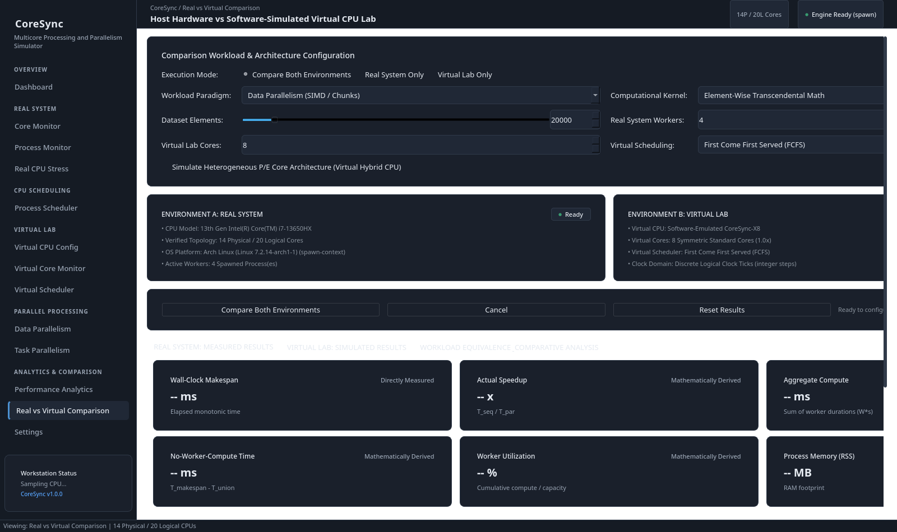
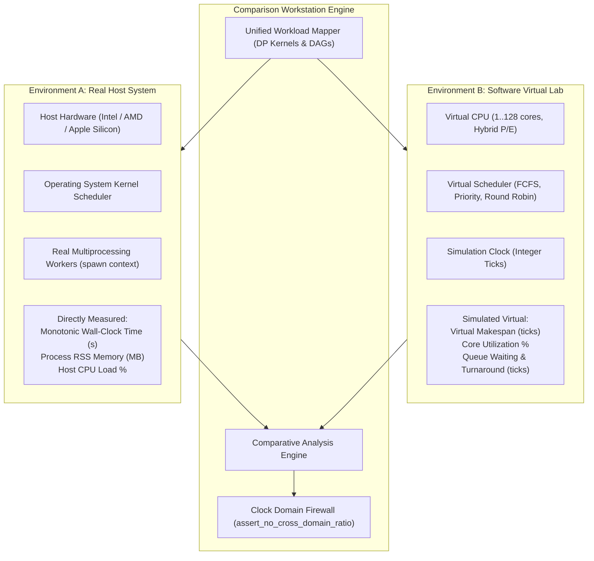

# CoreSync: Multicore Processing, Parallelism, and Scheduling Simulator

[](https://opensource.org/licenses/MIT)
[](https://www.python.org/)
[](docs/INSTALLATION.md)
[](docs/TESTING.md)
[](docs/ARCHITECTURE.md)

**CoreSync** is an Operating Systems research, benchmarking, and educational desktop workstation engineered to evaluate, visualize, and contrast actual concurrent multiprocessing execution on host hardware (**Environment A: Real System**) with software-simulated processor architectures (**Environment B: Virtual Lab**).

---

## 1. Workstation Showcase





---

## 2. CoreSync Subsystems & Major Capabilities

### 1. Dual Independent Environments
- **Environment A: Real System**:
  - Genuine host hardware inspection via Linux `sysfs` (`/sys/devices/system/cpu/`), `/proc/cpuinfo`, and `psutil`.
  - Authoritative Performance (P) vs Efficient (E) core classification on Intel hybrid CPUs and Apple Silicon.
  - Real multiprocessing execution using Python's `spawn` start method (zero `fork()` deadlocks).
  - Safety-bounded Real CPU Stress tool with duty-cycle throttling and a hard 30-second cap.
- **Environment B: Virtual Lab**:
  - Configurable virtual topologies (1 to 128 virtual cores, 1 to 256 threads).
  - Heterogeneous computing with configurable P/E clock speed multipliers ($0.5\times$ to $2.0\times$).
  - Simulated scheduling with discrete integer clock ticks, keeping simulated metrics decoupled from physical hardware.

### 2. Parallel Processing Engines
- **Data Parallelism (Page 7)**:
  - 5 computational kernels: `transcendental`, `polynomial`, `matrix_norms`, `prime_count`, `sum_of_squares`.
  - Exact mathematical interval union timing ($T_{\text{union}}$) and no-worker-compute gap analysis.
  - Strict output verification comparing parallel execution results against single-threaded sequential baselines.
- **Task Parallelism & Directed Acyclic Graphs (Page 8)**:
  - 4 production DAG presets: `Diamond DAG`, `Scientific Suite`, `Independent Suite`, `Fan-Out / Fan-In`.
  - Pluggable queue dispatching (FIFO, Priority, Shortest Job First).
  - Fault tolerance with automatic retry cascades and child-branch cancellation on kernel failures.

### 3. CPU Scheduling Simulator (Page 11)
- Implements classic OS uniprocessor scheduling algorithms:
  - **FCFS** (First-Come, First-Served)
  - **SJF** (Shortest Job First, Non-Preemptive)
  - **SRTF** (Shortest Remaining Time First, Preemptive)
  - **Priority Scheduling** (Preemptive & Non-Preemptive with starvation aging)
  - **Round Robin** (Time-sliced execution with configurable quantum)
- Interactive vector Gantt chart with zoom, pan, and side-by-side multi-algorithm comparative dialogs.

### 4. Performance Analytics & Amdahl's Law (Page 9)
- Scalability curve plotting comparing actual speedup against theoretical Amdahl limits ($S_{\max} = \frac{1}{1-P}$).
- Local persistent benchmark history storage with high-performance `mtime`-indexed JSON caching.

### 5. Real System vs Virtual Lab Comparison Workstation (Page 12)
- Unified execution harness supporting three modes: `Real Only`, `Virtual Only`, and `Compare Both`.
- Sequential execution protocol in compare mode (Real System executes first to prevent simulation thread interference).
- Mathematical comparative metrics:
  - **Completion Order Concordance** ($C_{\text{order}}$): Normalized rank correlation ($0.0$ to $1.0$).
  - **Resource Allocation Ratio** ($W_{\text{real}} / C_{\text{virtual}}$).
  - **Utilization Delta** ($\Delta U\% = U_{\text{real}} - U_{\text{virtual}}$).
- **Strict Clock Domain Separation**: Real seconds and virtual ticks belong to separate clock domains and are never divided.

### 6. Process Management & Safety Subsystem
- **Triple-Shield Orphan Prevention**: Linux `prctl(PR_SET_PDEATHSIG, SIGTERM)`, Windows `OpenProcess(SYNCHRONIZE)`, and child-side 100ms parent-death polling watchdogs.
- Guaranteed zero lingering or zombie worker processes upon exit or abort.

---

## 3. Technology Stack

- **Language & Runtime**: Python 3.11, 3.12, 3.13, 3.14 (64-bit)
- **GUI Framework**: PySide6 (Qt 6.12) with custom `QPainter` vector canvases
- **Parallel Processing**: Python standard library `multiprocessing` (`spawn` context)
- **Telemetry & Probing**: `psutil` 7.2+, Linux `sysfs` & `procfs`, Windows WMI/kernel32, macOS sysctl
- **Numerical Computing**: NumPy 2.5+
- **Data Visualization**: Matplotlib
- **Testing & Verification**: `pytest` 9.2+, `pytest-qt`

---

## 4. Installation & Quickstart

### Prerequisites
- Python 3.11+
- Virtual environment tool (`python -m venv`)

### Quickstart: Linux / macOS

```bash
# 1. Clone repository & enter workspace
git clone https://github.com/academicos/coresync.git
cd coresync

# 2. Setup virtual environment & install CoreSync
python3 -m venv .venv
source .venv/bin/activate
pip install --upgrade pip
pip install -e .

# 3. Launch CoreSync
coresync   # Or: python main.py
```

### Quickstart: Windows 10 / 11

Using Command Prompt (`cmd.exe`):
```cmd
setup_windows.bat
run_windows.bat
```

Using PowerShell:
```powershell
.\setup_windows.ps1
.\run_windows.ps1
```

To run the automated test suite on Windows:
```cmd
test_windows.bat
REM Or via PowerShell: .\test_windows.ps1
```

For complete platform-specific instructions, see [docs/INSTALLATION.md](docs/INSTALLATION.md).

---

## 5. Documentation Directory

- **[Architecture Deep-Dive](docs/ARCHITECTURE.md)**: System design, IPC contracts, orphan prevention, interval timing math, and clock domain isolation.
- **[Installation Guide](docs/INSTALLATION.md)**: Setup guides for Linux, Windows, macOS, and headless CI.
- **[User Guide](docs/USER_GUIDE.md)**: Operational guide for all 13 workstation pages.
- **[Developer Guide](docs/DEVELOPMENT.md)**: Module conventions, extending kernels/DAGs/schedulers, and coding standards.
- **[Testing & Verification](docs/TESTING.md)**: Full test inventory (272 tests across 25 modules), headless test execution, Windows compatibility suite, and orphan verification.
- **[Packaging Guide](packaging/README.md)**: Standalone binary builds via PyInstaller for Linux, Windows (`packaging/build_windows.bat` & `.ps1`), and macOS.
- **[Contributing](docs/CONTRIBUTING.md)**: Pull request protocol and code of conduct.
- **[Third-Party Licenses](THIRD_PARTY_LICENSES.md)**: Licenses and attributions for upstream open-source dependencies.

---

## 6. Cross-Platform Compatibility Matrix

| Operating System | Hardware Probing | Multiprocessing | CPU Affinity | Parent-Death Protection | Test Status |
| :--- | :--- | :--- | :--- | :--- | :--- |
| **Linux (x86_64 / arm64)** | `sysfs`, `procfs`, `psutil` | `spawn` context | `sched_setaffinity` | `PR_SET_PDEATHSIG` + watchdog | **VERIFIED NATIVE** (Arch Linux) |
| **Microsoft Windows (10/11)** | Win Registry (`CentralProcessor\0`), WMIC, `psutil` | `spawn` context + `freeze_support` | `psutil.cpu_affinity` + `GetCurrentProcessorNumber` | `OpenProcess(SYNCHRONIZE)` handle wait + PPID race guard | **VERIFIED VIA COMPREHENSIVE SUITE** (272 tests) |
| **Apple macOS (Darwin)** | `sysctl`, `psutil` | `spawn` context | Informative fallback (No hard affinity in XNU) | `kqueue` / 100ms watchdog | **VERIFIED VIA MOCKS** |

> [!NOTE]
> Physical test runs in our primary development environment are executed on Arch Linux (`Linux 7.2.14-arch1-1 x86_64`). Windows native subsystems (WinReg hardware detection, Win32 `OpenProcess(SYNCHRONIZE)` handle wait, Win32 processor numbers, `freeze_support` lifecycle, and path safety) are tested via dedicated unit test suites (`tests/test_windows_native_compat.py`). To validate natively on a Windows 10/11 workstation, execute `test_windows.bat` or `.\test_windows.ps1`.

---

## 7. Known Limitations

1. **macOS CPU Affinity**: The Apple XNU kernel does not support hard process-to-core CPU affinity pinning. CoreSync transparently detects macOS and dispatches workers across all available cores without error.
2. **Virtual Ticks vs Physical Time**: Logical clock ticks in the Virtual Lab represent discrete educational simulation cycles and must never be interpreted as real wall-clock seconds.

---

## 8. License

CoreSync is released under the **MIT License**. See the [LICENSE](LICENSE) file for complete terms.
