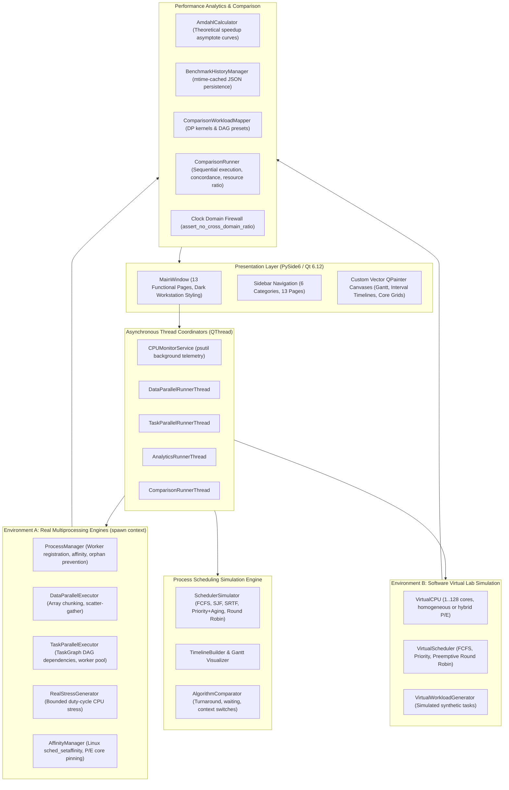
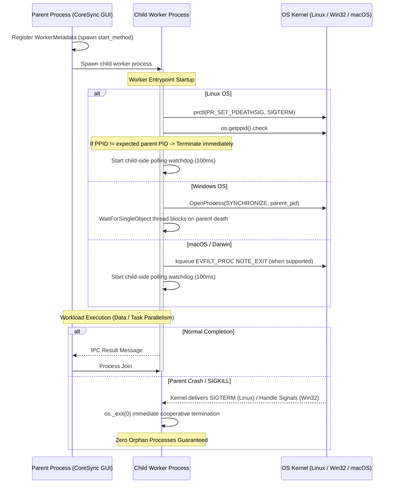
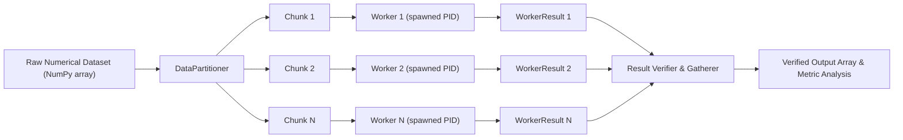
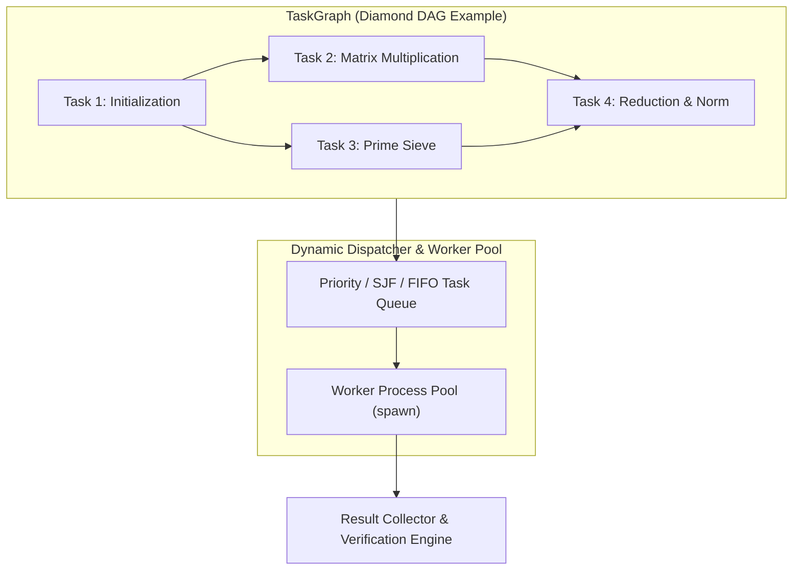
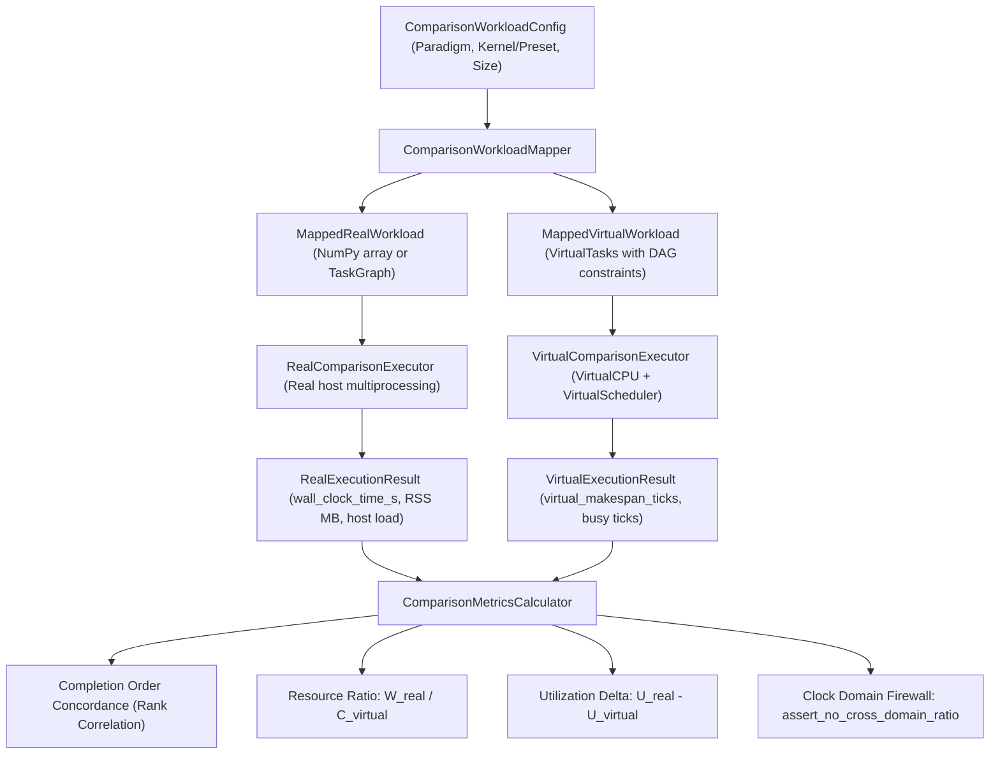

# CoreSync Architecture Documentation

## 1. Overview & System Mission

**CoreSync** is a unified Operating Systems research and educational workstation designed to demonstrate, benchmark, and contrast actual multicore execution on host hardware (**Environment A: Real System**) with idealized software simulation (**Environment B: Virtual Lab**).

---

## 2. Strict Architectural Invariants

CoreSync enforces strict separation of concerns across its architectural boundaries:

1. **Worker Isolation from Qt**:
   Worker processes spawned for Data Parallelism, Task Parallelism, and Real CPU Stress **MUST NEVER** import `PySide6` or any Qt modules. Worker entry points reside in standalone modules (`engine.data_parallel.worker`, `engine.task_parallel.worker`) communicating purely via pickle-safe IPC queues and primitive Python dataclasses.
2. **Process Spawn Context**:
   `multiprocessing.set_start_method("spawn", force=True)` is enforced at application startup. Forking is strictly prohibited to prevent deadlocks with Qt's C++ thread runtime and X11/Wayland display sockets.
3. **Clock Domain Separation**:
   Real System elapsed monotonic time (seconds) and Virtual Lab simulated time (discrete logical clock ticks) belong to separate, incommensurable domains. **Dividing seconds by ticks is strictly prohibited** by `assert_no_cross_domain_ratio`.

---

## 3. Process Management Subsystem

The unified `ProcessManager` (`engine/process_manager.py`) coordinates child worker lifecycles, resource allocation, CPU affinity, and orphan prevention across all execution engines.

### Triple-Shield Orphan Defense
1. **Kernel-Level Termination**: On Linux, `prctl(PR_SET_PDEATHSIG, SIGTERM)` instructs the Linux kernel to send `SIGTERM` to the child worker the instant the parent thread dies.
2. **Startup Race Check**: Between child fork/spawn and `prctl` execution, the parent could theoretically die. The child worker captures `expected_parent_pid` before enabling protection, invokes `prctl`, and immediately checks `os.getppid()`. If reparented to `systemd`/`init` (PID 1), it aborts immediately.
3. **Child-Side Watchdog Thread**: A dedicated daemon thread in every worker inspects parent liveness every 100ms. If the parent disappears, the child terminates itself without relying on parent-side cleanup.

---

## 4. Data Parallelism Subsystem

The Data Parallelism engine (`engine/data_parallel/`) visualizes and executes Scatter-Compute-Gather patterns on host hardware.

### High-Resolution Interval Instrumentation
Rather than calculating residuals by subtracting summed worker durations from makespan, CoreSync calculates the **Exact Mathematical Interval Union**:
$$T_{\text{union}} = \left| \bigcup_{i=1}^{W} [t_{\text{start}, i}, t_{\text{finish}, i}] \right|$$
$$T_{\text{no\_worker\_compute}} = T_{\text{makespan}} - T_{\text{union}}$$
This guarantees that worker overlap during concurrent execution does not distort elapsed non-compute overhead measurements.

---

## 5. Task Parallelism Subsystem

The Task Parallelism engine (`engine/task_parallel/`) implements a dynamic Directed Acyclic Graph (DAG) dependency executor.

### Fault Isolation & Retry Cascades
- Individual task failures trigger bounded exponential retries.
- If a task exceeds its maximum retry threshold, dependent child tasks are automatically canceled via dependency cascade while independent sibling branches continue uninterrupted.

---

## 6. CPU Scheduling Simulator

The CPU Scheduling engine (`engine/process_scheduler/`) models uniprocessor CPU scheduling policies:

- **FCFS**: First-Come, First-Served (non-preemptive).
- **SJF**: Shortest Job First (non-preemptive).
- **SRTF**: Shortest Remaining Time First (preemptive).
- **Priority**: Preemptive and Non-Preemptive with starvation aging.
- **Round Robin**: Time-sliced execution with configurable quantum.

### Aging Algorithm Integrity
Effective priority is updated strictly as a function of time spent in the `READY` queue:
$$\text{effective\_prio} = \text{initial\_prio} \pm \left\lfloor \frac{t_{\text{waiting}}}{\text{aging\_interval}} \right\rfloor \times \text{aging\_step}$$
Running time on the CPU does not contribute to aging; preempted processes resume accumulating waiting time from their exact preemption tick.

---

## 7. Real vs Virtual Comparison Subsystem

The Comparison Workstation (`engine/comparison/`) translates identical computational workloads into both real and virtual domains:

### Sequential Execution in Compare Both Mode
In `COMPARE_BOTH` mode, the Real System executes first, followed by the Virtual Lab. This eliminates host CPU contention and CPU cache pollution, guaranteeing pristine physical benchmark measurements.

